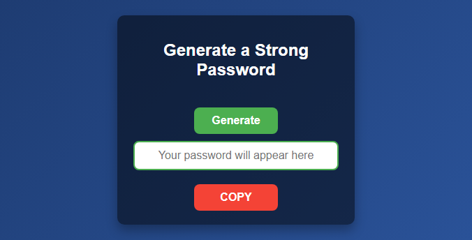

<!--
Copyright (C) 2026 M003aad
Licensed under the GNU AGPL v3.0 or later. See LICENSE for details.
-->
# SPassword

SPassword is a browser extension that generates a password and lets you copy it from the extension popup.

## Features

- Generate a 20-character password containing uppercase and lowercase letters, digits, and symbols.
- Copy the generated password to the clipboard from the popup.
- Load the extension locally in a compatible browser's developer mode; no installation package is required.

## Install

SPassword is loaded as an unpacked extension in developer mode:

1. Download or clone this repository to your computer.
2. Open your browser's extensions management page.
3. Enable **Developer mode**.
4. Select **Load unpacked** (or the browser's equivalent).
5. Choose the project folder containing `manifest.json`.
6. Pin or open SPassword from the browser toolbar.

Browser-specific instructions: **[add supported browser names and links]**.

## Use

1. Open SPassword from the browser toolbar.
2. Select **Generate**. A 20-character password appears in the popup.
3. Select **COPY** to copy the displayed password.

## Screenshots

### Popup

### Generated password

The password shown in the screenshot is an example only. Generate a new password for your own use.

## Contributing

Bug reports, feature proposals, and pull requests are welcome. See [CONTRIBUTING.md](CONTRIBUTING.md) for the local setup and contribution guidelines. For security issues, see [SECURITY.md](SECURITY.md).

## License

SPassword is distributed under the GNU Affero General Public License v3.0 (AGPL-3.0). See [LICENSE](LICENSE) for the full license text.

## Maintainer

Maintained by **M003aad**.
